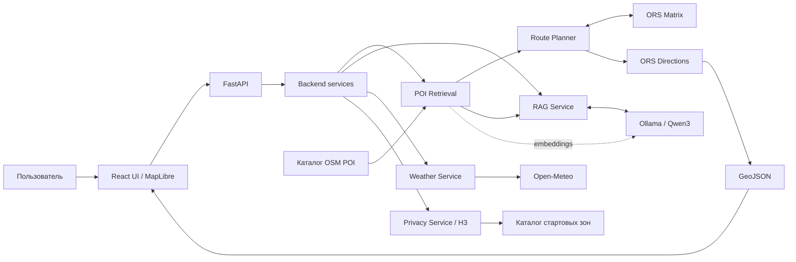

# VibeRoute — AI-планировщик городских прогулок

**VibeRoute** — интеллектуальный городской советчик для персонализированных пеших
прогулок по Астане по пожеланиям пользователя и доступному времени. В проекте собраны
реальные POI (городские объекты) OpenStreetMap, пешеходная маршрутизация OpenRouteService,
погода Open-Meteo, приблизительная геолокация H3 и AI-рекомендации на основе RAG.

Это **MVP для AITU Hackathon** с четырьмя стартовыми зонами и ограниченным покрытием.
Погода показывается отдельно; генеративные рекомендации доступны через RAG API.

**Оглавление**

- [Основные возможности](#основные-возможности)
- [Технологический стек](#технологический-стек)
- [Архитектура](#архитектура)
- [Структура репозитория](#структура-репозитория)
- [Системные требования](#системные-требования)
- [Установка и запуск — Windows PowerShell](#установка-и-запуск--windows-powershell)
- [Запуск без Ollama](#запуск-без-ollama)
- [Опциональный запуск AI](#опциональный-запуск-ai)
- [Главные API endpoints](#главные-api-endpoints)
- [Географическое покрытие](#географическое-покрытие)
- [Тестирование](#тестирование)
- [Безопасность и приватность](#безопасность-и-приватность)
- [Развёртывание](#развёртывание)
- [Команда и GitHub](#команда-и-github)

## Основные возможности

- Персонализированные прогулки на **30–180 минут**, до **трёх остановок**;
  бюджет включает пеший путь и плановое время посещений.
- Кольцевой маршрут с возвратом к старту или завершение на последней остановке.
- Реальная пешеходная геометрия ORS и интерактивная карта MapLibre.
- Подбор кофейни и парка/сада с учётом порядка; при невозможности полного
  маршрута API возвращает `no_route` с причиной.
- Поиск POI: BM25; при включённых embeddings — гибридный поиск **BM25 + embeddings + RRF**.
- Grounded RAG на локальных Qwen3 через Ollama: рекомендации с источниками
  и проверкой ответа сервером, отдельный `/api/v1/rag/query`.
- Погода Open-Meteo для выбранной стартовой зоны, с обработкой неизвестных данных.
- Приблизительное местоположение через **H3 resolution 8** по разрешению пользователя;
  ручной выбор старта доступен без геолокации.
- Интерфейс для компьютера и телефона. API поддерживает `ru`, `kk`, `en`;
  текущий UI преимущественно русскоязычный и отправляет `language: "ru"`.

**Границы MVP:** Route Planner использует retrieval и ORS, а текст маршрута формирует
детерминированно. LLM не вычисляет пешеходный путь. Влияние погоды на выбор маршрута
и полная локализация UI пока не реализованы. Live-изохрона не отображается:
зона доступности относится только к явно включаемому демонстрационному режиму.

## Технологический стек

| Компонент | Технологии | Назначение |
| --- | --- | --- |
| Frontend | React, TypeScript, Vite | Web UI и сборка |
| UI | Tailwind CSS, Lucide React | Стили и иконки |
| Maps | MapLibre GL JS | Карта, маркеры и отображение GeoJSON |
| Backend | Python, FastAPI, Pydantic, Pydantic Settings | REST API, валидация и конфигурация |
| Geo | OpenRouteService, HTTPX | Пешеходные маршруты и матрицы времени/расстояния |
| POI Data | OpenStreetMap, Overpass API | Сбор реальных городских объектов в локальный каталог |
| Search | BM25, Qwen3 embeddings, RRF | Hybrid Retrieval; BM25 и RRF реализованы в проекте |
| AI | Ollama, Qwen3 | Рекомендации на основе найденных источников — grounded RAG |
| Weather | Open-Meteo | Погодные данные по стартовой зоне |
| Privacy | H3, h3-py (`h3`), h3-js | Приблизительная геолокация и выбор ближайшей зоны |
| Tests | pytest, Playwright | Backend и браузерные проверки |
| Tooling | uv, npm, Ruff, mypy, oxlint | Зависимости, сборка, форматирование и анализ |

Зависимости: [pyproject.toml](apps/api/pyproject.toml), [uv.lock](apps/api/uv.lock),
[package.json](apps/web/package.json) и [package-lock.json](apps/web/package-lock.json).

## Архитектура



Основной поток: **запрос пользователя → Retrieval → Route Planner → ORS Directions
→ GeoJSON → MapLibre**. ORS Matrix помогает выбрать остановки в пределах бюджета;
Directions возвращает фактическую пешеходную геометрию и расчётное время пути.
GeoJSON приходит в UI через ответ FastAPI. Погода запрашивается отдельно от маршрута.
H3 выбирает существующую стартовую зону, а не создаёт точный GPS-старт.

Подробности: [интеграция API](docs/developer-3-api-integration.md), [retrieval и RAG](docs/retrieval-rag.md), [Geo adapter](packages/geo/README.md).

## Структура репозитория

```text
N0NE/
├── apps/
│   ├── api/                 # FastAPI, сервисы, схемы, тесты и smoke-скрипты
│   └── web/                 # React UI, MapLibre и Playwright E2E
├── packages/
│   ├── geo/                 # ORS adapter, каталожные старты и offline replay
│   └── data_pipeline/       # Сбор и валидация OSM POI через Overpass
├── data/
│   ├── astana/              # Проверяемый снимок POI: JSON и GeoJSON
│   └── geo/                 # Сохранённые географические ответы и offline-демо
├── shared/                  # anchors.json — четыре стартовые зоны
├── contracts/               # JSON Schema для POI, Weather и Privacy
├── docs/                    # Интеграционные инструкции и отчёты
├── scripts/                 # Общие служебные скрипты
├── tests/                   # Проверки на уровне репозитория
├── .env.example             # Пример серверных настроек ORS и погоды
└── README.md
```

## Системные требования

- **Git**, **Python 3.11** и **uv** ([установка uv](https://docs.astral.sh/uv/getting-started/installation/)).
  Backend manifest допускает Python `>=3.11`; ниже используется 3.11.
- **Node.js**, совместимый с Vite **8.3.4**: `^20.19.0 || >=22.12.0`
  по lock-файлу, и **npm >=8.1.0** по требованию MapLibre.
- Современный браузер с WebGL 2, поддерживаемый MapLibre.
- **ORS API key** для live-маршрутов; ключ хранится на сервере.
- Интернет для ORS, Open-Meteo, загрузки онлайн-карт и первоначальной установки зависимостей.
- **Ollama** — опционально для локальных embeddings и LLM.

POI API и lexical retrieval работают по включённому в репозиторий снимку, без
Ollama и без обращения к Overpass. Построение live-маршрута требует доступного ORS.
Без ключа API запускается, но planner возвращает `no_route / ors_unconfigured`.

## Установка и запуск — Windows PowerShell

### Шаг 1. Клонируйте репозиторий

```powershell
git clone https://github.com/bekw-eg/N0NE.git
cd N0NE
```

### Шаг 2. Подготовьте серверное окружение

```powershell
Copy-Item .env.example .env
```

Откройте корневой `.env`, заполните `ORS_API_KEY` своим ключом и добавьте настройки
для первого запуска без моделей:

```dotenv
ORS_API_KEY=YOUR_ORS_API_KEY
LLM_PROVIDER=disabled
SEMANTIC_ENABLED=false
```

Сохраните `ORS_BASE_URL=https://api.heigit.org/openrouteservice` из примера.
`.env` исключён из Git. Все параметры — в [примере API](apps/api/.env.example)
и [Settings](apps/api/app/core/config.py).
Настройки не читают `.env` автоматически: ниже он явно загружается через `--env-file`.
Относительные пути из примера API рассчитаны на рабочую директорию `apps/api`.
Переменные `$env:` имеют приоритет над `.env`; уберите прежние значения или откройте новый терминал.

### Шаг 3. Запустите Backend

В этом же терминале из корня репозитория:

```powershell
cd apps/api
$env:PYTHONUTF8='1'
$env:PYTHONPATH='.;../../packages/geo/src;../../packages/data_pipeline/src;../..'
uv sync --python 3.11
uv run uvicorn app.main:app --env-file ../../.env --host 127.0.0.1 --port 8000 --no-access-log
```

`PYTHONPATH` помогает Python 3.11 импортировать локальные пакеты на Windows,
в том числе из пути с кириллицей. Эти `$env:`-переменные действуют в текущем терминале.
Оставьте сервер работающим; остановка — `Ctrl+C`.

| Сервис | Локальный адрес |
| --- | --- |
| API | [http://127.0.0.1:8000](http://127.0.0.1:8000) — базовый адрес; у `/` нет отдельной страницы |
| Swagger | [http://127.0.0.1:8000/docs](http://127.0.0.1:8000/docs) |
| Health | [http://127.0.0.1:8000/health](http://127.0.0.1:8000/health) — ожидается `{"status":"ok"}` |

### Шаг 4. Запустите Frontend в новом терминале

Откройте **новый терминал в корне `N0NE`**:

```powershell
cd apps/web
npm ci
npm run dev
```

Откройте **[http://localhost:5173](http://localhost:5173)**. Vite proxy передаёт
`/api/v1/...` на FastAPI `http://127.0.0.1:8000`, сохраняя путь запроса.
Для development frontend `.env` и настройка CORS не нужны:
`VITE_API_BASE_URL` в этом режиме не используется. Порт 5173 должен быть свободен.
Перед повторным `npm ci` остановите Vite этого проекта: Windows может удерживать
его native-модули и возвращать `EPERM` при переустановке.

### Шаг 5. Проверьте интерфейс

1. Откройте frontend и выберите **EXPO / Nur Alem**.
2. Введите **«Хочу спокойную прогулку возле EXPO»**.
3. Выберите **60 минут** и включите кольцевой маршрут.
4. Нажмите **«Построить маршрут»**.
5. Проверьте остановки, линию на карте, сводку времени и погодный блок.
   На телефоне используйте вкладки «Карта» и «Маршрут».

Дистанция и число остановок зависят от запроса и актуальных ответов ORS.
При `no_route` интерфейс показывает причину; при сбое погоды — отсутствие данных.
Кнопка «Показать демо» включает отдельно помеченный пример и не проверяет live API.

## Запуск без Ollama

```dotenv
LLM_PROVIDER=disabled
SEMANTIC_ENABLED=false
```

Добавьте эти строки в корневой `.env` и перезапустите Backend. POI, lexical retrieval
(BM25), Weather и H3 остаются доступны; планирование работает при доступном ORS.
RAG API возвращает ответ по источникам со статусом `retrieval_only`, без генерации LLM.

## Опциональный запуск AI

Установите [Ollama для Windows](https://ollama.com/download/windows), запустите
его локальный сервер и загрузите модели из конфигурации проекта:

```powershell
ollama pull qwen3:4b-instruct
ollama pull qwen3-embedding:0.6b
```

Замените настройки в корневом `.env` и перезапустите Backend:

```dotenv
LLM_PROVIDER=ollama
OLLAMA_BASE_URL=http://127.0.0.1:11434
LLM_MODEL=qwen3:4b-instruct
EMBEDDING_MODEL=qwen3-embedding:0.6b
SEMANTIC_ENABLED=true
```

- **BM25** ищет по словам в исходных данных.
- **Qwen3 embedding** преобразует тексты и запрос в векторы для семантического поиска.
- **RRF** (Reciprocal Rank Fusion) объединяет lexical и semantic ранжирование.
- **Qwen3 instruct** выбирает рекомендации из найденного контекста и допустимых
  объяснений; сервер проверяет IDs и текст. Это ограниченная генерация по источникам.

Первая индексация может занять время. Нужны запущенный Ollama и доступные модели;
кэш векторов не заменяет модель для нового запроса. При недоступности embeddings
поиск переходит в `lexical`, при сбое генерации — в `retrieval_only`, с предупреждениями.
Маршрут не вызывает instruct-модель. Подробности — [retrieval и RAG](docs/retrieval-rag.md).

## Главные API endpoints

| Метод | Endpoint | Назначение |
| --- | --- | --- |
| GET | `/health` | Готовность API |
| GET | `/api/v1/pois` | Каталог POI, поиск `q`, фильтр `category`, пагинация |
| GET | `/api/v1/pois/{poi_id}` | POI по исходному ID |
| POST | `/api/v1/retrieval/search` | Lexical или hybrid retrieval |
| POST | `/api/v1/rag/query` | Рекомендации по источникам и статус генерации |
| POST | `/api/v1/routes/plan` | Пешая прогулка из каталожной стартовой зоны |
| GET | `/api/v1/weather` | Погода по обязательному `start_anchor_id` |
| POST | `/api/v1/privacy/resolve-h3` | Выбор стартовой зоны по H3 resolution 8 |

Пример запроса `POST /api/v1/routes/plan`:

```json
{
  "start_anchor_id": "expo_nur_alem",
  "duration_minutes": 60,
  "query": "Хочу спокойную прогулку возле EXPO",
  "round_trip": true,
  "language": "ru"
}
```

Оба результата возвращают HTTP 200: `success` содержит `stops` и `route_geojson`,
`no_route` — `reason`, пустые остановки и `route_geojson: null`.
Полный контракт — в [Swagger](http://127.0.0.1:8000/docs) и
[OpenAPI](http://127.0.0.1:8000/openapi.json); дополнительные JSON Schema — в
[contracts/](contracts/). Отдельного файла Route Planner в `contracts/` сейчас нет.
Примеры ответов и обработка ошибок — в [руководстве интеграции](docs/developer-3-api-integration.md).

## Географическое покрытие

| Стартовая зона | `start_anchor_id` |
| --- | --- |
| Mega Silk Way | `mega_silk_way` |
| EXPO / Nur Alem | `expo_nur_alem` |
| Ботанический сад | `botanical_garden` |
| Бульвар Нуржол | `nurzhol_boulevard` |

Последний проверенный [снимок](data/astana/pois.json), собранный **19 октября 2026 года**,
содержит **497 реальных OSM POI**. Покрытие ограничено районом MVP:
широта `51.075–51.145`, долгота `71.385–71.455`; это не весь город.
Источники стартов и ограничения точек находятся в [shared/anchors.json](shared/anchors.json).
У EXPO текущее OSM-имя — **Alem.ai**; историческое название не подтверждает работу музея.
Данные предоставлены © [OpenStreetMap contributors](https://www.openstreetmap.org/copyright),
лицензия **ODbL-1.0**. Подробнее — [описание каталога](data/astana/README.md).

## Тестирование

### Backend

Из корня, в отдельном терминале после установки зависимостей:

```powershell
cd apps/api
$env:PYTHONUTF8='1'
$env:PYTHONPATH='.;../../packages/geo/src;../../packages/data_pipeline/src;../..'
$env:LLM_PROVIDER='disabled'
$env:SEMANTIC_ENABLED='false'
uv run pytest -q
uv run ruff check .
uv run ruff format --check .
uv run mypy app scripts
```

Тесты backend используют локальные данные и подмены внешних сервисов, без live ORS.
Дополнительный HTTP smoke: `uv run python scripts/smoke.py` из `apps/api` с теми же
переменными окружения. Скрипт сам запускает временный Uvicorn на свободном порту.

### Frontend

Backend на `:8000` и frontend на `:5173` должны работать **до запуска E2E**.
Для подготовки зависимостей остановите Vite; в отдельном терминале из корня:

```powershell
cd apps/web
npm ci
npm run lint
npm run build
npx playwright install chromium
```

Запустите Vite по шагу 4, затем из `apps/web` выполните `npm run test:e2e`.
Playwright сам поднимает тестовые FastAPI на `:8001` и `:8002` для симуляции
отказов ORS/Open-Meteo; эти порты должны быть свободны. Нужны зависимости Backend и uv.
Для уже установленного Chrome можно задать `$env:PLAYWRIGHT_CHANNEL='chrome'`
и пропустить установку Chromium.

Live ORS-сценарии по умолчанию пропускаются. Включайте их отдельно при настроенном
серверном ключе и работающих сервисах, из `apps/web`:

```powershell
$env:RUN_LIVE_ORS='1'
npm run test:e2e
Remove-Item Env:RUN_LIVE_ORS
```

Предыдущие проверки описаны в [отчёте frontend](docs/frontend-integration-report.md).
Это исторический отчёт; текущую доступность провайдеров проверяйте отдельно.

## Безопасность и приватность

- GPS преобразуется в H3 **в браузере**, после нажатия кнопки и разрешения пользователя.
  Privacy API принимает только H3 resolution 8; точные GPS-поля отклоняются.
- H3 раскрывает приблизительную область и **не гарантирует анонимность**:
  IP, время и повторные запросы могут позволить связать местоположения.
- ORS API key хранится только на сервере. Секреты нельзя помещать во frontend и `VITE_*`.
- Публичная геолокация требует HTTPS; localhost допускается для разработки.
- Исключите GPS, H3, тела запросов и чувствительные тексты из логов reverse proxy,
  APM и аналитики. `--no-access-log` отключает только access logs Uvicorn.
- Координаты центров объектов не подтверждают входы; неизвестные часы работы,
  текущая доступность, тишина и другие пожелания остаются неизвестными.
  Время посещений — плановая оценка; сохраняйте предупреждения и атрибуцию OSM.

## Развёртывание

Для production необходимо:

1. Развернуть FastAPI за HTTPS reverse proxy и настроить серверный `ORS_API_KEY`.
2. Собрать frontend через `npm run build` и разместить `apps/web/dist` на HTTPS-хостинге.
3. До сборки задать `VITE_API_BASE_URL` в `apps/web/.env.production` по
   [примеру](apps/web/.env.example): HTTPS origin Backend, допустим суффикс `/api`,
   без `/api/v1`. Либо оставить пустое значение и настроить same-origin `/api`
   reverse proxy с сохранением пути `/api/v1/...`. Vite dev proxy в сборку не входит.
4. Для разных origins задать Backend `CORS_ORIGINS` как JSON-массив точных HTTPS
   origins frontend без пути и завершающего `/`; wildcard не поддерживается.
5. Не помещать секреты в `VITE_*`; проверить логи и публичный сценарий
   браузер → API → ORS → маршрут на карте, а также Weather и H3.

Публичный production deployment в этой инструкции не заявляется.
Подробная конфигурация — в [frontend README](apps/web/README.md).

## Команда и GitHub

| Роль | Зона ответственности |
| --- | --- |
| Developer №1 | Data, Geo, Weather, Privacy |
| Developer №2 | Backend, Retrieval, RAG, Route Planner |
| Developer №3 | Frontend, UI/UX, MapLibre, API Integration |

Репозиторий: **[bekw-eg/N0NE](https://github.com/bekw-eg/N0NE)**.
